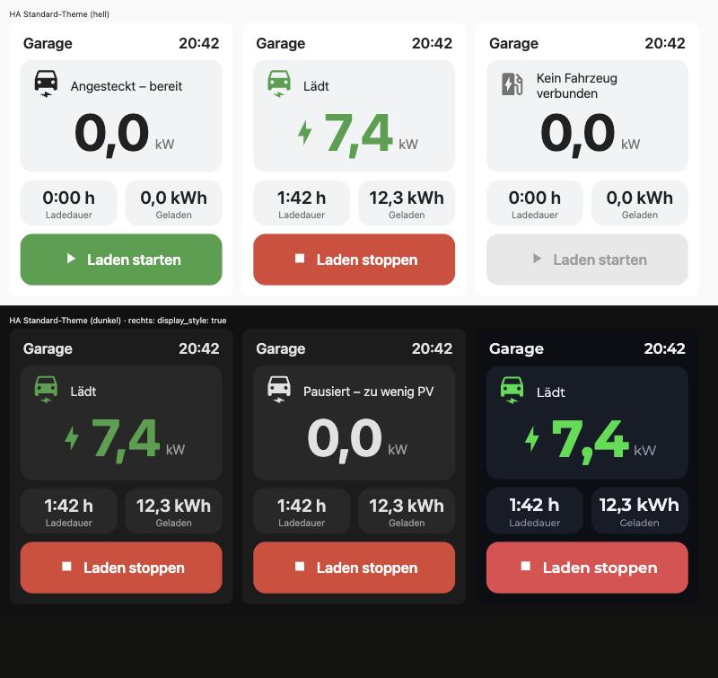
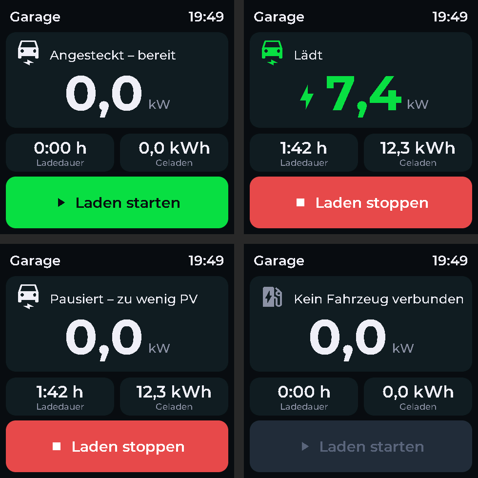

# Garage Charger

[](https://hacs.xyz/docs/faq/custom_repositories)
[](https://github.com/yannick80/ha-garage-charger/actions/workflows/validate.yml)

A Home Assistant integration and dashboard card for a **wallbox in the
garage**, plus a matching **ESPHome touch display**. Inspired by
[evcc-garage-display](https://github.com/tobymarks/evcc-garage-display), but
it runs on Home Assistant instead of evcc.

| Dashboard card | Wall display (ESP32-S3, 4″) |
|---|---|
|  |  |

Built for an **Alpha ESS** wallbox (via
[homeassistant-alphaESS](https://github.com/CharlesGillanders/homeassistant-alphaESS))
with a **Shelly 3EM-63T Gen3** measuring the charging power. It works with any
charger whose status sensor reports `preparing` / `charging` / … and that
exposes start/stop button entities.

## Features

- **Charging time** (`Ladedauer`) and **charged energy** (`Geladen`, kWh) per
  session:
  - **Start:** the session starts at the first change to `charging`.
  - **Background pauses:** the session continues through pauses (e.g. the
    wallbox stops for lack of PV). Time only counts while actually charging.
  - **Stop button:** pressing Stop anywhere (display, dashboard, app) resets
    both values to zero.
  - **Unplugging without Stop:** the values are kept until the next session
    starts.
  - **Persistence:** values survive Home Assistant restarts.
- **Dashboard card** `custom:garage-charger-card`:
  - shows status, power, clock, charging time, energy and one big
    Start/Stop button;
  - is **loaded automatically** by the integration: it is registered as a
    dashboard resource, so you add no resource and copy no file;
  - uses your **theme colours** (light and dark); `display_style: true`
    switches to the dark look of the garage display;
  - has a visual editor (pick the charger, title, clock, look);
  - works on old wall tablets and WebViews (legacy-safe JavaScript);
  - follows the HA language (German/English).
- **ESPHome display** with the same look (see [`esphome/`](esphome/)).

### Start / Stop logic

| Charger status | Text | Button |
|---|---|---|
| `available` | Kein Fahrzeug verbunden | Start, disabled |
| `preparing` | Angesteckt – bereit | **Laden starten** |
| `charging` | Lädt | **Laden stoppen** |
| `suspended_evse` | Pausiert – zu wenig PV | **Laden stoppen** |
| `suspended_ev` | Vom Fahrzeug pausiert | **Laden stoppen** |
| `finishing` / `faulted` / other | Ladevorgang beendet / Fehler am Lader / Lader offline | disabled |

Cloud chargers report a new status with a delay. After a press the button
shows "Bitte warten…" until the status changes (at most 2 min).

## Installation (HACS)

1. HACS → ⋮ → **Custom repositories**: add
   `https://github.com/yannick80/ha-garage-charger` as type **Integration**.
2. Search for **Garage Charger**, install it, and restart Home Assistant.
3. **Settings → Devices & services → Add integration → Garage Charger** and
   pick:
   - the charger **status** sensor (e.g. `sensor.<serial>_ev_charger_status`),
   - the charger **start** and **stop** buttons
     (e.g. `button.<serial>_start_charging` / `_stop_charging`),
   - the **charging power** sensor (e.g. the Shelly's
     `sensor.<shelly>_total_active_power`),
   - the **energy** meter of the wallbox (e.g. the Shelly's
     `sensor.<shelly>_total_active_energy`).

   With the name "Garage" this creates `sensor.garage_ladedauer` and
   `sensor.garage_geladen`. You can change the entities later under
   *Configure*.
4. Dashboard → **Add card → Garage Charger Card**. The editor selects the
   first configured charger and takes all entities from the integration.
   In YAML:

```yaml
type: custom:garage-charger-card
entry_id: <id of the Garage Charger entry>   # filled in by the editor
title: Garage        # optional
show_clock: true     # optional
display_style: false # optional: dark garage-display look instead of theme colours
```

Any entity can be overridden explicitly (`status_entity`, `power_entity`,
`start_button`, `stop_button`, `duration_entity`, `energy_entity`). Cards
written for 1.0.0 with explicit entities keep working.

If something is missing, the card shows a hint and disables the button. It
never guesses an entity.

### Upgrading from 1.0.0

- Open the integration → **Configure** and add the **start button** and the
  **charging power** sensor. The card needs both and tells you if they are
  missing.
- If you ever added `/local/garage-charger-card.js` as a resource by hand,
  remove it (*Settings → Dashboards → Resources*). The integration loads the
  card itself and logs a warning while the old entry exists.

### Card not showing ("Custom element doesn't exist")

1. Open `/garage_charger/garage-charger-card.js` in the browser. A 404 means
   the integration is not loaded.
2. *Settings → Dashboards → Resources* should list
   `/garage_charger/garage-charger-card.js?v=…` with type *JavaScript module*.
3. Do a hard reload (Ctrl+Shift+R). In the companion app or on a wall
   display, clear the frontend cache.

## ESPHome display (optional)

You need a **Guition ESP32-4848S040C** (ESP32-S3, 4″ 480×480 IPS, capacitive
touch). It is the same board as evcc-garage-display.

1. Set the entity IDs under `substitutions` in
   [`esphome/garage-display.yaml`](esphome/garage-display.yaml).
2. Create a device in the ESPHome Device Builder and paste the YAML. Add the
   values from `secrets.yaml.example` to your secrets.
3. Flash the first time over USB-C. Later updates go over Wi-Fi.
4. In HA: *Settings → Devices → ESPHome → Garage Display → Configure* → enable
   **"Allow the device to perform Home Assistant actions"**.

Display behaviour:
- The screen turns off after 120 s, but never while charging.
- The first touch only wakes it.
- Any status change wakes the screen.
- A red Wi-Fi icon means the connection to HA is lost.

## Hardware note

The Shelly 3EM-63T Gen3 goes into the distribution board on the wallbox
supply. **That is mains work and must be done by a qualified electrician.**

## Development

```bash
pip install -r requirements_test.txt
pytest                      # integration, card registration, card source rules
node --test tests/*.mjs     # card behaviour (no npm dependencies)
```

See [AGENTS.md](AGENTS.md) for the rules this repo follows.

## License

MIT
